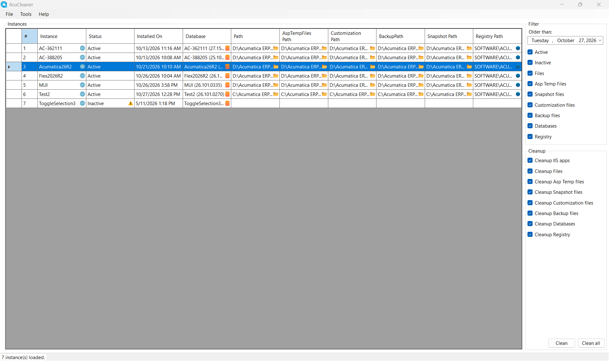
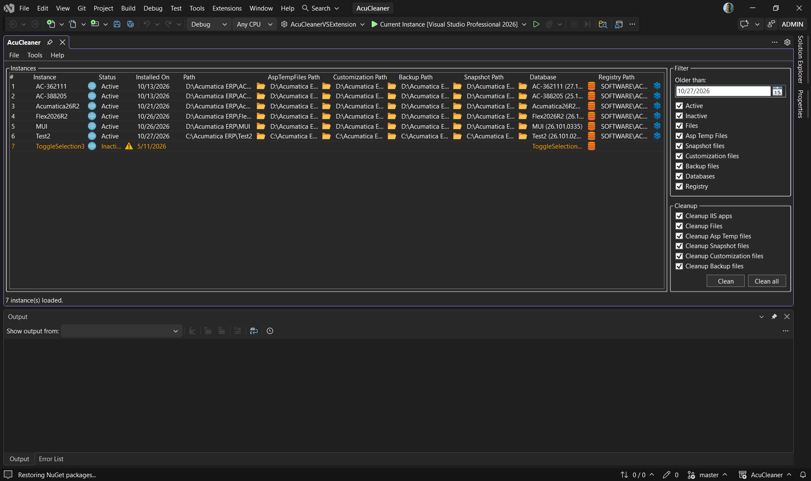

# AcuCleaner

AcuCleaner is a utility tool for finding and cleaning Acumatica instance remnants on a local development machine. It brings related IIS applications, folders, SQL Server databases, and Acumatica registry entries together in one list. It can also apply a few maintenance changes to selected instances.

## What it finds

AcuCleaner combines information from local IIS, configured local folders associated with IIS instances, SQL Server LocalDB, and local registry. The list shows an instance's status and installation date, along with any detected paths and database information.

- **Active** entries are found in IIS.
- **Inactive** entries are remnants found outside IIS, such as on disk, in a database, or in the registry.
- Folder artifacts include instance files, ASP.NET temporary files, snapshots, customizations, and backups.

Discovery depends on the local machine and the resources accessible to the current Windows account. SQL Server discovery uses Windows integrated authentication and checks LocalDB and `localhost`.

## Get started

### Standalone Windows app

1. Open the [Releases page](https://github.com/milan-randjelovic-acumatica/AcuCleaner/releases).
2. Download **`AcuCleaner-win-x64.zip`** from a release's assets. Do not use GitHub's automatically generated source-code archives.
3. Extract the entire ZIP into a folder on a Windows x64 machine. Keep the extracted files together.
4. Run `AcuCleaner.exe` and approve the Windows administrator prompt.

The published app is self-contained and does not require a separate .NET installation. It is unsigned, so Windows may show a security warning.

### Visual Studio extension

The solution also contains an AcuCleaner Visual Studio extension. When its VSIX is available, install it in Visual Studio 2022 version 17.14 or later, then open **Tools > AcuCleaner**. The extension hosts the same instance list, cleanup options, and administrative tools inside a Visual Studio tool window. The release ZIP described above is the standalone app, not the VSIX.

## Using AcuCleaner

1. Start the app and wait for the instance list to load. Use **File > Refresh** (or **F5** in the extension) to scan again.
2. Use **Older than** to set the latest installation date to include. The **Active/Inactive** and resource checkboxes control which matching entries appear. Changing filters refreshes the list.
3. Select one or more rows. Double-click an instance name to open its local site in a browser; double-click a path, database, or registry location to open it in the associated Windows tool when supported.
4. In **Cleanup**, choose which resource types to remove, then choose **Clean** to process selected rows. **Clean all** selects every row currently shown by the filters and processes those rows.
5. Confirm the warning dialog and watch the status bar for progress or errors.

Cleanup categories can be enabled independently:

- IIS application registrations
- Instance folders
- ASP.NET temporary files
- Snapshot files
- Customization files
- Backup files
- SQL Server databases
- Acumatica registry entries

All cleanup categories are enabled by default. The list filters decide which instances are visible; the cleanup checkboxes decide which resource types are acted on. An instance can therefore have only some of its resources removed.

## Administrative tools

From the **Tools** menu, select rows first, then choose an operation. Each operation asks for confirmation.

- **Reset Password** sets the Acumatica default password for admin user in each selected instance database. It also changes the database's password-policy settings and disables scheduled automation and push notification hooks. Change the password promptly and use only on instances you administer.
- **Enable Modern UI Switch** sets `EnableSiteMapSwitchUI=true` in the selected instance's `Web.config`.
- **Extend Session Timeout** sets the session timeout to 1,440 minutes (one day) where a session-state setting exists in `Web.config`.
- **Apply All Patches** performs all three operations above on the selected instances.

## Important safety notes

- Cleanup is destructive and has no undo. Database cleanup drops the selected database; folder cleanup recursively deletes selected folders; registry cleanup removes selected Acumatica registry subkeys. Back up anything you may need before continuing.
- Review the selected rows, cutoff date, and cleanup categories before confirming. **Clean all** means all currently displayed rows, not every possible Acumatica instance on the machine.
- AcuCleaner stops IIS while removing IIS application registrations and starts it again afterward. Plan for a brief interruption to local IIS-hosted sites.
- Run with administrator rights. The standalone app requests elevation, and the operations may need access to IIS, protected files, the registry, and SQL Server.
- The utility is intended for local Acumatica development/administration environments. Do not use it against production data or instances unless you have an approved backup and change plan.
